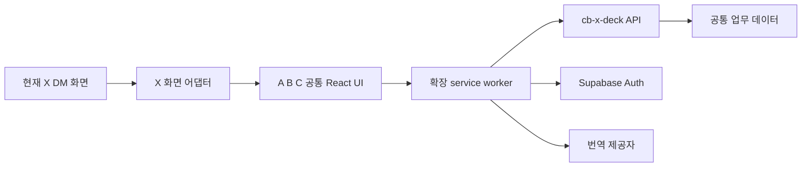

# cb_x_extension 목업 기반 구현 계획서

작성일: 2026-10-04

현재 React 목업을 실제 X 1대1 DM에서 사용하는 Chrome 확장 프로그램으로 전환한다. 콘텐츠 기획 담당자가 대화 중 협찬을 확인하고, 예약을 등록·수정하며, 안내와 번역을 사용할 수 있게 하는 것이 목표다. 업무 데이터와 판정은 cb-x-deck 서버를 사용한다.

이 문서는 구현 계획이다. 현재 실제 익스텐션·로그인·번역·API 연동이 완성됐다는 의미가 아니다. 개발 대상 저장소의 실제 이름은 `cb_x_extension`이다. 요청에 쓰인 `cb_x_extention`은 이 프로젝트를 뜻하는 것으로 해석했다.

함께 읽을 문서: [cb-x-deck 구현 계획](2026-10-04-cb-x-deck-extension-product-implementation.md), [공통 API 구현 계획](2026-10-04-extension-product-api-implementation.md). 공통 저장 규칙과 API 계약의 기준은 API 계획서에 둔다.

## 1 기준 자료와 현재 상태

| 자료 | 구현에 사용하는 내용 |
| --- | --- |
| [익스텐션 README](../../../../cb_x_extension/README.md) | 승인된 A·B·C 배치, 예약 2단계, 상세·PDF·번역 설정의 최신 화면 동작 |
| [초기 상세 기획](<../../../../cb_x_extension/docs/초기 기획/구현 상세 기획.md>) | DM 전용, 로그인, 상대 식별, 배지, 단가·메모, 번역·캐시 요구사항 |
| [웹 목업 인계](<../../../../cb_x_extension/docs/인계/cb-x-deck 기능 추가 목업 인계.md>) | 웹·익스텐션의 역할 분담과 기존 작업 연결 |
| [최신 웹 목업 설명](../../mockups/x-extension-web-20261004.md) | 확정 전 수정, 통합 일정, 종료 유형·자동 방문 판정 등 후속 변경 |
| [선행 연구](../../research/x-extension-information-and-feature-plan-20261002.md) | 재사용 후보. 승인된 목업과 충돌하는 제안은 적용하지 않음 |

현재 저장소는 Vite·React·TypeScript 기반 목업이며 `manifest.json`, 실제 content script와 service worker가 없다. 디자인 선택·번역 설정 일부만 로컬에 남고 업무 데이터·PDF는 메모리에서 초기화된다. `mockup/`의 과거 HTML 비교안보다 현재 `src/`와 README의 A·B·C 정의를 우선한다.

레거시 `cb_translate 1.13.2`는 번역 보호·입력 흐름을 참고한다. x_tracker 연결, 여러 메신저 지원, 레거시의 공용 AI 키 주입 방식은 새 확장에 옮기지 않는다.

## 2 구현 범위

| 영역 | 실제 구현 결과 | 범위 경계 |
| --- | --- | --- |
| 설치와 로그인 | MV3 패키지, 회사 Google 로그인, 연결 상태·만료·로그아웃 | 웹과 같은 Supabase 프로젝트·사용자 정책 사용 |
| X 대화 감지 | 본인·상대·대화방 식별, 전환 시 이전 정보 제거 | 1대1 DM. 그룹은 지원 안내, 상대 추측 금지 |
| A·B·C | A 채팅 상단 바, B 오른쪽 패널, C 플로팅 카드 | 세 배치 모두 제공. B 기본, 사용자 선택 복원 |
| 협찬 조회 | 진행중·완료·취소/노쇼, 작업 상세, 웹 바로가기 | 오류·미등록·0건을 구분 |
| 채팅 목록 배지 | 확인된 상대별 진행 단계와 방문·업로드 D-day | 표시 이름으로 매칭하지 않음 |
| 메모와 단가 | 고정 메모, KRW/JPY 기본 단가 조회·수정, 충돌 안내 | 작업 비용과 협찬 메모는 조회. 기본 단가 수정으로 계약 금액 변경 금지 |
| 방문 예약 | 양식 삽입 → 응답 파싱 → 편집 시트 복사·대기 저장, 기존 예약 수정·확정 | 캠페인 생성·원고 작성·게시 확인·정산 처리는 웹에서 수행 |
| 예약 종료와 동의서 | 가능한 취소·방문 노쇼·업로드 노쇼, PDF 첨부·교체·열기·제거 | 서버가 반환한 허용 행동만 표시. 종료 기록 보존 |
| 클리닉 안내 | 운영 캘린더, 지도·안내 복사·삽입, 일본어 예약 양식 | 본점만 지원. 운영 중은 예약 가능 수량을 뜻하지 않음 |
| 빠른 메시지 | 검색·미리보기·현재 상대 핸들 치환·초안 뒤 삽입 | 팀 공용 저장은 제안 범위로 별도 결정 필요 |
| 번역 | 메시지별 수신 번역, 발신 번역 미리보기, ON/OFF·언어·개인 키 설정 | 전체 채팅 수집·자동 수신 번역을 기본으로 두지 않음 |

## 3 목업 간 차이의 처리

| 차이 | 계획에서 적용하는 기준 |
| --- | --- |
| 익스텐션은 대기 수정에도 사유를 선택하고 웹은 바로 수정 | 공통 서버 규칙은 최신 웹 기준인 확정 전 횟수 제외를 제안한다. 익스텐션의 기존 사유 선택 UI를 유지해도 서버는 `waiting_edit`로 기록한다. 확정 전 사유 선택을 없애는 UI 변경은 적용 여부를 별도로 결정한다. |
| 익스텐션은 업로드 기한 자동 계산만 제공하고 웹은 직접 편집 가능 | 익스텐션에 직접 편집 기능을 추가하지 않는다. 웹에서 정한 기한을 조회하고, 방문일 수정 시 서버가 기본/직접 지정 여부에 따라 유지·갱신한다. |
| 이전 기획은 희망·확정 일시를 별도 입력 | 하나의 방문 일시와 확정 여부를 사용한다. 날짜 입력만으로 확정하지 않으며 확정 동작을 따로 둔다. |
| 익스텐션의 오래된 종료 버튼과 웹의 최신 날짜별 종료 조건 | 서버 `allowedActions`로 통일한다. 새 종료 유형은 카드와 필터에서 구분하되 익스텐션에 게시·정산 행동을 추가하지 않는다. |
| 초기 다지점 기획과 최신 본점 운영 | 본점만 사용하고 지점 선택·추가를 제외한다. 장소 식별자는 기존 참조 보존용으로 유지한다. |
| 초기 수신 자동 번역과 최신 기본 접힘 | 번역 ON이어도 메시지의 `번역 보기`를 눌렀을 때 호출한다. 기존 번역은 다시 열 때 재사용한다. |

목업 차이를 승인된 동일 동작으로 취급하지 않는다. 위 표의 제안과 API 계획서의 결정 목록을 첫 개발 단계에서 기록하고 테스트 기준으로 고정한다.

## 4 확장 프로그램 구조

B는 X 페이지에 주입하는 오른쪽 패널이다. 현재 목업의 동작을 Chrome 네이티브 `sidePanel`로 바꾸지 않는다. 확장 UI는 자체 Shadow Root에서 렌더링하고 X DOM 접근은 어댑터에 모은다.

### 제안 파일 구성

| 경로 | 책임 |
| --- | --- |
| `manifest.json`, `vite.config.ts` | MV3 권한·entry·정적 번들. 개발과 운영 API 호스트 분리 |
| `src/extension/content.tsx` | X 화면에서 mount·unmount, 공통 UI 연결 |
| `src/extension/background.ts` | 인증, API·번역 통신, 요청 검증·갱신 |
| `src/extension/options.tsx` | 회사 연결, 개인 번역 키·언어, 배치 설정 |
| `src/x/adapter.ts`, `selectors.ts` | 현재 X의 방·상대·입력창·메시지·목록 감지 |
| `src/x/conversationContext.ts` | X 계정·대화방·상대와 전환 세대 번호 관리 |
| `src/x/composer.ts`, `sendController.ts` | 초안 보존 삽입, 번역 적용, 한 번의 전송 흐름 |
| `src/api/client.ts`, `contracts.ts` | API DTO와 에러 코드 처리. 서버가 반환한 상태 사용 |
| `src/state/` | 현재 방의 조회·편집 초안·접힘 상태·캐시 |
| 기존 `App.tsx`와 예약 컴포넌트 | 샘플 화면과 실제 어댑터를 분리해 재사용 |

권한 기본안은 `storage`, `identity`와 X·제품 API·Supabase·선택한 번역 제공자의 정확한 호스트다. `cookies`, `webRequest`, 모든 사이트 접근은 기본으로 요청하지 않는다. 실제 경로 매칭은 X 검증 결과로 확정한다.

API 통신은 service worker에서 수행한다. content script는 주입된 사이트의 출처 제약을 받으므로 직접 제품 API를 호출하지 않는다. 메시지 타입과 payload를 제한하고 임의 URL fetch 기능을 만들지 않는다. [Chrome 교차 출처 요청 문서](https://developer.chrome.com/docs/extensions/develop/concepts/network-requests)

worker의 전역 변수만으로 세션·저장 결과를 보관하지 않는다. 중단·재시작 후 필요한 상태를 복구하고, 서버 쓰기는 같은 요청 식별자로 재확인한다. [Chrome service worker 수명 문서](https://developer.chrome.com/docs/extensions/develop/concepts/service-workers/lifecycle)

## 5 X 화면 연결 검증

가장 먼저 실제 X 새 채팅 화면에서 다음 항목을 확인한다. Shadow DOM 존재는 기존 기획의 관찰이며 현재 화면의 root 접근 가능 여부·구조까지 검증 완료된 사실로 보지 않는다.

1. 본인 X 계정과 상대 핸들·숫자 ID를 신뢰할 수 있게 읽는지 확인한다. 숫자 쌍의 한쪽을 근거 없이 상대라고 정하지 않는다.
2. open Shadow Root와 일반 DOM에서 방 전환·메시지 목록·입력창을 읽는다. closed root 때문에 불가능하면 원인을 기록하고, 공식 지원 가능한 대체 범위가 정해질 때까지 감지 기능의 완료로 처리하지 않는다.
3. X의 실제 입력 상태를 갱신하는 삽입 방법을 검증한다. 텍스트만 보이고 전송 버튼이 비활성인 구현은 통과시키지 않는다.
4. 전송 버튼·Enter·Shift+Enter·IME 조합·이미지 전송과 rerender를 검증한다.
5. 가상화된 채팅 목록의 재사용 노드에서 기존 상대의 배지가 남지 않는지 확인한다.

어댑터는 지원 기능을 `capabilities`로 반환한다. 상대 조회만 가능한 화면에서 전송이나 예약 저장까지 가능한 것처럼 표시하지 않는다. 관찰자는 대상 root로 제한하고 unmount 시 정리해 이벤트·패널 중복을 막는다.

방 전환마다 세대 번호를 증가시키고 이전 요청을 취소한다. 모든 응답은 `회사 사용자 + 본인 X 계정 + conversationKey + 상대 + generation`이 현재 context와 같을 때만 반영한다. 방 전환 후 예약 초안은 원래 상대에게 묶어 보관하되 저장 버튼은 잠근다.

## 6 주요 사용자 흐름

### 연결과 상대 조회

회사 로그인 후 현재 상대를 조회한다. `일치`, `미등록`, `확인 필요`, `읽지 못함`, `연결 만료`, `조회 실패`, `협찬 0건`은 각각 표시한다. 신규 상대는 확인한 핸들 옆 `명부에 추가`를 눌렀을 때만 프로필 유료 조회·등록을 수행한다. 숫자 ID 불일치이면 예약·단가·메모 쓰기를 막고 웹 확인으로 안내한다.

### 협찬과 배지

진행중의 건수와 카드 목록은 동일한 서버 조건을 쓴다. 완료·종료 기록은 탭으로 조회하고 업로드 노쇼도 종료 기록에 포함한다. A는 2건, B는 3건, C는 1건씩 표시하는 현재 목업을 유지한다. 서버 페이지 크기와 화면 표시 묶음은 분리한다.

목록 배지는 보이는 상대만 일괄 조회한다. 단계는 작업마다 표시하고 D-day는 서버의 서울 날짜 판정을 사용한다. `웹에서 보기`는 같은 작업으로 이동하며, 캠페인 첫 화면만 여는 링크로 대체하지 않는다.

### 예약 등록

캠페인·상대·본점을 확인한다. 기본 캠페인 목록은 방문협찬 유형 중 예정·진행 중이며 종료 캠페인은 필터로 볼 수 있다. 캠페인이 없거나 클리닉이 미연결이면 웹 설정으로 안내한다.

첫 단계에서 고객 양식을 기존 DM 초안 뒤에 넣는다. 사용자가 직접 전송하고 `예약 이어하기`로 응답 파싱 단계에 돌아온다. 원문을 붙여 넣고 `예약 정보 파싱`을 누르면 서버의 검증된 결과를 원문 옆 편집 시트로 보여준다. 재파싱은 기존 편집 내용을 확인 없이 덮어쓰지 않는다.

`파싱 결과 복사하기`는 화면의 현재 텍스트를 그대로 복사한 뒤 서버에 대기 저장한다. 복사 실패이면 저장하지 않고 직접 복사를 제공한다. 복사 성공·저장 실패이면 두 결과를 구분하고 같은 요청 ID로 저장 재시도한다. 저장 성공 후 방이 바뀌어도 원래 상대의 결과만 갱신한다. 구체적인 멱등 순서는 API 계획서를 따른다.

같은 캠페인·상대의 기존 visit 작업을 선택해 예약을 붙일 수 있다. 이미 예약이 있으면 해당 예약을 연다. 새 작업을 명시적으로 선택한 경우에만 작업·예약을 함께 만든다. 익스텐션 예약 폼에는 금액을 넣지 않는다.

### 예약 수정과 PDF

일정·입력 항목·기재 시트는 서버 저장 결과 한 건으로 갱신한다. 확정 후에는 수정 사유를 선택하고, 인플 요청 3회 초과는 제한 안내를 거쳐 `요청 기록·협찬 중단`을 명시적으로 누를 때만 종료한다. 뒤로가기·닫기는 초안만 보존하며 이력·횟수를 바꾸지 않는다.

예약 변경 내역은 일정 아래·동의서 위에 둔다. 최근 3건과 전체 조회를 제공한다. 종료된 예약은 읽기 전용으로 확인하고 수정·확정·파일 교체를 제공하지 않는다.

PDF는 10 MiB 이하만 허용한다. 새 파일이 검증·업로드·연결에 모두 성공한 뒤 기존 첨부를 교체한다. `File`·`Blob`을 runtime 메시지로 그대로 보낼 수 있다고 가정하지 않는다. 초기안은 크기를 제한한 chunk 문자열 전송과 worker 업로드이며, 10 MiB 왕복·메모리 사용·worker 재시작을 검증한다. 파일은 로컬 설정이나 업무 캐시에 영구 저장하지 않는다.

### 안내와 단가

독립 클리닉 안내는 클리닉을 선택하고, 예약 안에서는 연결한 클리닉을 사용한다. 지도·예약 양식·빠른 메시지는 기존 입력을 보존해 덧붙인다. 복사·삽입의 부분 실패를 각각 안내한다. 공휴일 정보가 없으면 `확인 필요`, 운영 중이면 `운영시간 안내`로 표현한다.

단가는 바꾼 항목만 저장하고 버전을 함께 보낸다. 빈 값·0·비용 없음은 각각 다른 의미다. 통화 변경은 환전이 아니라는 도움말을 두며, 충돌이면 최신 값과 내 입력을 비교한 뒤 다시 저장한다.

## 7 번역 구현과 확인 사항

수신 번역은 메시지별 opt-in으로 실행한다. 캐시 키는 본인 계정·방·메시지 ID·원문 hash·목표 언어이고, 원문 편집·언어 변경 때만 다시 번역한다. 메시지 전체를 제품 DB에 수집하지 않는다.

발신은 목업의 번역 미리보기를 구현한다. 초기 기획의 전송 시 번역 방식은 실제 X 전송 검증 후 선택할 구현안이다. 추천안은 번역 결과를 먼저 보여주고 사용자가 전송을 누르게 하는 방식이다. 전송 시 번역을 채택한다면 Enter와 버튼을 동일한 처리로 모으고, 번역 실패·방 전환에는 원문 보존과 전송 중단, 성공에는 한 번만 전송을 보장한다. 실패한 전송을 자동 재전송하지 않는다.

개인 DeepL 키 설정 요구는 유지한다. DeepL은 일반 브라우저에서 직접 API 호출하는 방식을 지원하지 않는다고 안내한다. 확장 worker의 host permission 호출은 일반 페이지와 구분되지만 DeepL의 실제 응답까지 보장하지 않으므로 첫 검증에서 Free/Pro 호출을 확인한다. [DeepL CORS 안내](https://developers.deepl.com/docs/best-practices/cors-requests), [Chrome 교차 출처 요청](https://developer.chrome.com/docs/extensions/develop/concepts/network-requests)

직접 호출이 안 되면 인증된 서버 중계에 개인 키를 요청 동안만 전달하는 대안을 검토한다. 서버 키 저장이나 공용 키로의 전환을 조용히 적용하지 않는다. 이 대안의 endpoint·보관 정책·비용 주체를 API 계약에 추가한 뒤 구현한다.

## 8 설정과 캐시

| 데이터 | 제안 보관 방식 |
| --- | --- |
| A·B·C, 번역 ON/OFF·언어 | 확장 `storage.local`. 목업의 X 페이지 localStorage는 사용하지 않음 |
| 액세스·refresh token, 번역 키 | 초기 보안 기본안은 trusted context의 `storage.session`. 브라우저 재시작 후 다시 연결·입력. 영구 저장 UX는 별도 결정 |
| 예약·DM 초안 | 사용자·X 계정·방에 묶은 session 저장, TTL 24시간 제안. 로그아웃·계정 변경 시 삭제 |
| 협찬 조회 캐시 | session 내 짧은 TTL, 마지막 확인 시각 표시. 새로고침·방 복귀·쓰기 성공 때 갱신 |
| 클리닉·메시지 목록 | 버전별 캐시. API 오류는 마지막 값과 갱신 실패를 함께 표시 |
| 동의서 PDF | 서버 비공개 저장소. 확장에는 현재 선택한 파일과 짧은 열기 URL만 유지 |

Chrome session storage는 브라우저 재시작 등에 지워지고 기본적으로 content script에 노출되지 않는다. local storage는 기본 노출되므로 민감한 값의 접근 레벨을 제한해야 한다. 보관 선택은 이 동작을 전제로 한다. [Chrome Storage API](https://developer.chrome.com/docs/extensions/reference/api/storage)

## 9 개발 순서와 완료 기준

| 단계 | 구현 작업 | 선행 조건 | 완료 기준 |
| --- | --- | --- | --- |
| EXT 0 | 최신 규칙 차이 확정, 실제 X 어댑터·DeepL·OAuth 검증, 고정 확장 ID·빌드 구성 | API 0 계약 검토 | 상대 감지·삽입·수신 관찰 가능 범위, 번역 호출·로그인 방식의 검증 기록 |
| EXT 1 | MV3 설치, 로그인, A·B·C, 상대 요약·배지·웹 이동 | API 1 인증·조회 | 실 X 방 전환에서 이전 정보·배지 유출 없음, 조회 실패와 0건 구분 |
| EXT 2 | 고정 메모·단가, 클리닉 안내·지도·양식, 빠른 메시지 | API 2 관리·운영시간 | 웹 변경을 다음 조회에 반영, 단가 충돌 입력 보존, 삽입 후 X 전송 가능 |
| EXT 3 | 예약 등록·기존 작업 연결·수정·확정·이력·종료 | API 3 예약 command | 동일 예약 ID 유지, 멱등 재시도·횟수·종료 제한·기한 유지 일치 |
| EXT 4 | PDF 영구 저장 연결, 수신·발신 번역, session 복구 | API 4 파일, EXT 0 번역 결정 | 첨부 실패 시 이전 파일 보존, 번역 실패·방 전환에 잘못된 전송 없음 |
| EXT 5 | 실 X 통합 QA, 배포 패키지·설치 안내·레거시 전환 | 웹·API 통합 QA | 승인된 전체 흐름과 A·B·C 검증, 레거시와 중복 가로채기 없음 |

단계는 의존 순서이며 납기 약속이 아니다. EXT 0에서 실제 X DOM 접근 실패·번역 방식 변경이 발견되면 영향을 기록하고 해당 기능 일정을 다시 산정한다. 화면 배치 작업보다 이 검증을 먼저 마친다.

## 10 검증과 배포

UI 구현 전 cb-x-deck의 UX 원칙을 함께 적용한다. 동작이 드러나는 라벨과 버튼 옆 한 줄 도움말을 두고, 결과에는 판단·다음 행동을 포함한다. 파싱 버튼 명칭을 다듬는 제안은 웹 계획서와 같이 적용 여부를 결정한다. 비용이 발생하는 번역·응답 정리·프로필 조회는 실행 버튼으로 시작하고, 원문 입력이나 방 전환만으로 유료 호출을 실행하지 않는다.

자동 테스트는 상대 context 차단, 배지 재사용, 초안 보존, 예약 요청 재시도, 번역 중복 방지처럼 업무 결과가 달라지는 규칙에 집중한다. 목업 정책 테스트를 그대로 복사해 서버 규칙을 별도로 소유하지 않는다. API 공통 fixtures로 상태·횟수·기한·금액 표현을 대조한다.

실 X에서는 빠른 방 전환, 그룹방, 본인 X 계정 전환, 상대 핸들 변경·숫자 ID 불일치, 채팅 목록 가상화, 한국어 IME, Shift+Enter, 이미지 단독, worker 재시작, 로그인 만료, 네트워크 단절, 복사 실패, PDF 10 MiB 경계를 검증한다. 세 배치와 확대 화면·좁은 창에서 대화 입력 공간과 키보드 동작을 확인한다.

빌드는 기존 `npm run build`를 확장 entry까지 포함하도록 변경한다. 개발용 sample 페이지와 실제 패키지는 별도 entry로 유지하며 sample 상대·API 주소·실패 체험 버튼이 운영 패키지에 섞이지 않게 검사한다.

첫 배포는 사내 제한 파일럿을 제안한다. API 기능 플래그로 쓰기를 단계적으로 열고, 배포 방식은 사내 배포 또는 Chrome Web Store 중 담당자가 결정한다. 설치·연결·개인 번역 키 설정·레거시 비활성화·오류 복구 안내를 제공한다. 제품 서버는 지원하는 클라이언트 버전을 공개하고, 구버전 쓰기는 계약 변경 시 차단한다.

## 11 착수 시 결정할 항목

| 항목 | 권장안 | 결정 전 영향 |
| --- | --- | --- |
| 확정 전 익스텐션 사유 선택 | 서버 횟수는 최신 웹 규칙, 사유 UI는 단순화 검토 | 공통 fixtures와 예약 편집 UI |
| 발신 번역 | 미리보기 후 사용자 전송 | 전송 가로채기 구현·실 X QA 범위 |
| 번역 키·로그인 영구 보관 | session 보관부터 시작 | 브라우저 재시작 UX와 설치 안내 |
| DeepL worker 호출 실패 대안 | 개인 키의 일시적 서버 중계 검토 | API endpoint·키 처리·비용 정책 |
| 팀 공용 빠른 메시지 | 웹 관리·익스텐션 조회의 초기 포함 제안 | 관리 화면·API 2 작업량 |
| 운영시간 밖 예약 | 경고와 사유 후 기록 허용 제안 | 양쪽 예약 저장 검증 |

이 문서 작성 작업에서는 앱 코드·DB·배포를 변경하지 않는다. 실제 기능 QA 후 머지할 때 사용자에게 달라지는 점을 cb-x-deck `src/content/updates.ts`에 기록한다.
