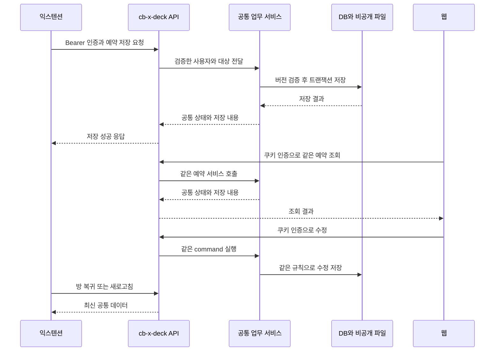

# 익스텐션과 cb-x-deck 연동 API 구현 계획서

작성일: 2026-10-04

익스텐션과 웹에서 같은 인플루언서·작업·예약·클리닉 설정을 읽고 수정하도록 공통 서버 서비스를 만든다. cb-x-deck이 업무 데이터와 판정의 기준이며, 익스텐션은 현재 X 대화의 상대를 확인해 API를 호출한다. 양방향 연동은 서로 API 서버를 따로 운영하는 방식이 아니라 같은 저장 서비스와 조회 결과를 사용하는 방식이다.

함께 읽을 문서: [익스텐션 구현 계획](2026-10-04-cb-x-extension-implementation.md), [cb-x-deck 구현 계획](2026-10-04-cb-x-deck-extension-product-implementation.md). 이 문서는 제안 API 계약이며 현재 endpoint가 구현돼 있다는 뜻이 아니다. 새 모델·경로·한도는 구현 착수 시 계약으로 고정한다.

## 1 확인한 현재 구조

현재 웹 API는 Supabase 쿠키를 읽는 `requireAllowedUser`·`requireMember`를 사용하고, 회사 도메인과 Google provider를 함께 검사한다. `proxy.ts`는 API에서도 쿠키 세션 처리를 거친다. 익스텐션의 Bearer token은 이 경로에 아직 연결돼 있지 않다.

기존 influencer·campaign task·client·settlement store와 API를 재사용한다. 기존 외부 정산용 공용 키는 확장 인증으로 사용하지 않는다. 현재 캠페인·인플루언서·클라이언트는 전사 공유 엔티티이며 이 API가 가상의 workspace 소속이나 미구현 역할 권한을 전제로 하지는 않는다.

기준 자료는 [최신 웹 목업](../../mockups/x-extension-web-20261004.md), [익스텐션 README](../../../../cb_x_extension/README.md), [초기 상세 기획](<../../../../cb_x_extension/docs/초기 기획/구현 상세 기획.md>)이다. 최신 웹의 변경은 익스텐션의 모든 화면이 이미 따라간 것으로 보지 않는다.

## 2 공통 업무 계약

아래는 두 화면의 데이터가 달라지지 않게 하는 계약 제안이다. 목업에서 일치하는 규칙은 유지하며 차이가 있는 항목은 12절의 결정 목록과 함께 고정한다.

| 항목 | 공통 서버 규칙 |
| --- | --- |
| 협찬 단위 | `campaign_task` 1행. 같은 예약의 날짜 수정으로 새 작업을 생성하지 않음 |
| 예약 관계 | visit task당 예약 최대 1개. 캠페인·상대는 task로 결정, 본점은 campaign의 client 소속 |
| 상대 식별 | 정규화한 핸들 정확 매칭. 숫자 ID 불일치·동명이인은 자동 연결하지 않음 |
| 원문과 시트 | 고객 응답 원문과 담당자가 저장한 최종 시트만 업무 데이터로 보관. 영구 파싱 결과 스냅샷은 별도로 두지 않음 |
| 날짜 | 시트의 방문 일시 한 값과 확정 여부 사용. 희망·확정 시각을 중복 입력·저장하지 않음 |
| 확정 | 명시적인 confirm command. 날짜 입력·시트 복사만으로 확정하지 않음 |
| 변경 횟수 | 확정 전 수정·첫 확정의 변경은 제외하는 최신 웹 규칙을 권장. 확정 후 customer request의 실제 변경 저장 1건당 1회 |
| 횟수 제한 | 3회 허용. 4번째는 명시적인 stop command로 요청 기록·종료만 남기며 새 변경값을 적용하지 않음 |
| 이력 | 정정도 전후 이력 저장. 무변경·닫기·사유 선택·PDF 변경은 횟수 증가 없음 |
| 기본 기한 | 방문 다음 날이 1일차, 14일차까지. 영업일 계산 아님. 2026-12-28 → 2027-01-11 |
| 직접 기한 | 웹에서만 편집 UI 제공. 익스텐션 방문일 수정도 직접 지정한 기한을 유지. 새 방문일보다 이르면 재확인 |
| 일정 저장 | 예약 연결 task의 `scheduled_on`이 업로드 기한의 저장 기준. 최종 시트의 기한도 같은 트랜잭션으로 갱신 |
| 비용 | 작업 `no_cost`와 금액 0/null 분리. 기본 단가 수정으로 작업 금액 자동 변경 금지 |
| 완료·정산 | 무상은 게시 확인 시 완료·정산 제외. 유상은 기존 지급 결과로 완료. 활성 정산 중 금액·통화·noCost 변경 금지 |
| 운영시간 | 날짜 예외 → 공휴일 → 요일. 운영/휴무/확인 필요. 잔여 예약 수량을 의미하지 않음 |
| 본점 | client당 본점 하나. 이번에는 지점 추가·접수 ON/OFF 제외 |
| 안내·복사 | DM 초안 삽입과 시트 복사를 구분. 복사는 클리닉 전달 완료가 아니며 복사 시각을 기록하지 않음 |

### 방문 상태와 허용 행동

방문 단계와 작업의 공통 6단계는 분리한다. 공통 단계는 기존 `flowStage`에 비용 없음·종료 분기를 추가한다. 방문 단계는 다음 순서로 파생하며 원고 상태를 조건에 쓰지 않는다.

| 우선순위 | 방문 단계 | 조건 |
| --- | --- | --- |
| 1 | cancelled / visit_no_show / upload_no_show | 해당 종료 사실 존재. 공통 단계는 `canc` |
| 2 | completed | 지급 완료 또는 게시 확인 + noCost |
| 3 | settling | 취소되지 않은 활성 정산 요청 |
| 4 | uploaded | 게시 확인 |
| 5 | visited | 수동 방문 완료 또는 확정된 방문일이 서울 오늘보다 이전 |
| 6 | confirmed | 예약 확정됨 |
| 7 | waiting | 예약 존재, 미확정 |
| 별도 | unregistered | 예약 없는 기존 visit. 레거시 방문 기록은 별도 제공 |

확정 방문일 다음 날 00:00부터 서버 판정상 방문으로 바뀐다. **제안 구현:** 초기에는 조회와 command 시 서버 날짜로 파생해 브라우저가 닫혀 있어도 결과가 맞게 한다. 화면 갱신용 자정 타이머는 서버 상태를 대신하지 않는다. 자동 방문은 실제 방문 증명이 아니라 운영상 단계이며 수동 완료와 구분한다. 자동 처리를 별도 DB 사건으로 남겨야 한다면 후속 job과 멱등 기록을 추가한다.

| 현재 조건 | 허용할 방문 행동 |
| --- | --- |
| 대기 | 수정·확정·취소. PDF 첨부 불가 |
| 확정·방문일 이전 | 사유 있는 수정·취소·PDF 관리 |
| 확정·방문일 당일 | 사유 있는 수정·취소·방문 완료·방문 노쇼·PDF 관리 |
| 방문 | 사유 있는 예약 수정·업로드 노쇼·게시 확인. 일반 취소·방문 노쇼 불가 |
| 업로드·정산 | 종료 불가. 기존 일정 수정의 허용 범위는 결정 목록에서 고정 |
| 완료·종료 | 예약 수정·확정·파일 교체 불가. 읽기·파일 열기 허용 |
| 예약 없는 기존 방문 완료 작업 | legacy 사실을 보존하고 업로드 노쇼 가능 여부를 서버가 판정 |

서버 응답의 `allowedActions`는 UI 안내용이다. 모든 command는 트랜잭션 안에서 최신 상태·서울 날짜로 다시 검증한다. 오래 열린 종료창의 자정 경합도 검사한다.

## 3 서버와 클라이언트 구성



확장 경로는 `/api/extension/v1`을 제안한다. 기존 웹 API와 새 웹 예약·클리닉 API는 같은 `reservationCommands`, `clinicStore`, `influencerStore`를 호출한다. 기존 경로 전체를 외부에 노출하거나 모든 웹 API 응답 구조를 한 번에 바꾸지 않는다.

확장은 DOM 감지·삽입·개인 설정·조회 캐시만 담당한다. 요청 횟수·상태·정산 가능 여부·D-day·기한 갱신은 서버 결과를 쓴다. 웹의 공통 표시 함수와 서버 판정은 공유하고 확장에는 DTO와 공통 계약 fixture를 배포한다.

## 4 로그인과 요청 인증

1. 확장 로그인은 기존 Supabase 프로젝트의 Google OAuth를 사용한다. `chrome.identity.launchWebAuthFlow`와 PKCE를 제안하고 확장별 고정 redirect URL을 등록한다. `state`, verifier, redirect를 요청 단위로 묶고 code를 token으로 교환한다. 실제 Supabase 설정과 고정 확장 ID로 먼저 검증한다. [Chrome Identity API](https://developer.chrome.com/docs/extensions/reference/api/identity), [Supabase Google 로그인](https://supabase.com/docs/guides/auth/social-login/auth-google)
2. 확장은 worker에서 `Authorization: Bearer <access_token>`을 보낸다. 웹 쿠키를 읽어 훔쳐 쓰거나 refresh token을 제품 API에 전달하지 않는다.
3. `requireExtensionMember(req)`를 추가해 JWT의 서명·만료·issuer·audience·subject를 확인하고 기존 회사 도메인·Google provider 정책을 동일하게 적용한다. `getClaims(jwt)`의 명시 token 검증을 사용하되 설치 SDK·프로젝트 signing key와 함께 확인한다. 비대칭 키가 아니면 검증이 Auth 서버 호출일 수 있다. [Supabase getClaims](https://supabase.com/docs/reference/javascript/auth-getclaims)
4. 쓰기의 담당자는 검증한 identity로 `resolveMember`에서 결정한다. body의 actorId·담당자 이름·권한 표시는 신뢰하지 않는다.
5. `proxy.ts`는 경계가 정확한 확장 API prefix와 OPTIONS에 대해 쿠키 refresh를 생략한다. 해당 경로는 모든 handler에서 Bearer guard를 실행한다. prefix 생략은 인증 우회가 아니다. 기존 웹 경로·개발 목업 예외는 별도 유지한다.
6. 만료 시 worker가 refresh를 한 번만 수행한다. 성공하면 같은 요청 식별자로 재시도하고 실패하면 연결 만료와 입력 보존을 표시한다. 로그아웃은 확장 token·캐시 삭제이며 서버 원격 회수·별도 session table은 추가하지 않는다. 기존 로컬 JWT 검증의 즉시 회수 한계는 유지한다.

제품 API와 Supabase 호스트를 manifest에 명시하고 content script 대신 worker에서 fetch한다. 인증서버 callback 외에 웹에서 확장으로 token을 postMessage하는 범용 브릿지는 만들지 않는다.

CORS가 필요한 호출에 대해서만 운영·staging·개발 확장 origin allowlist를 적용한다. `OPTIONS`는 업무 조회 없이 응답하며 `Authorization`, `Content-Type`, `If-Match`, `Idempotency-Key`, `X-Client-Version`을 허용한다. 응답에는 `Vary: Origin`을 사용한다. Origin이나 확장 ID는 사용자 인증 수단이 아니며 Origin이 없는 worker 요청도 유효 JWT를 검증한다. 확장 API는 쿠키 인증·`credentials: include`를 사용하지 않는다.

## 5 저장 모델과 제약

모든 이름은 제안이며 migration 번호는 착수 때 확보한다. 기존 SQL 실행 방식에 맞게 재실행 가능한 migration을 만든다.

| 엔티티 | 주요 필드와 DB 제약 |
| --- | --- |
| `visit_reservation` | `id`, `task_id UNIQUE`, `location_id`, `source_text`, `sheet_text`, 검증된 `fields`, `confirmed_at`, `deadline_mode`, `version`, 생성·수정 actor/time. task는 visit·배정 상대 필수 |
| `reservation_change` | reservation FK, actor, reason, before/after fields와 sheet, 요청 회차, 시각, operation ID unique. 과거 전후 값이 없으면 null을 그대로 표시 |
| `reservation_end` | task 기준 종료 종류·사유·시각·actor·보존 snapshot. 활성 종료는 task당 1건 |
| `reservation_consent` | reservation FK, object key, 원본 파일명·MIME·size·검증 상태·actor/time·attachment version. 교체/제거 이력 |
| `campaign_task` 추가 | `no_cost NOT NULL DEFAULT false`, `version`, 수동 방문 완료 시각·actor. 기존 비용 JSON·posted·정산 구조 유지 |
| `clinic_location` | client FK, 본점 식별자. client별 현재 본점 unique, 참조 중 삭제 금지 |
| `clinic_settings` | 주간 시간·점심·휴무, holiday policy, 지도·언어별 안내, settings version |
| `clinic_date_exception` | location+date unique, 운영/휴무·시간·메모 |
| `clinic_template_revision` | 고객 양식/기재 시트 별 revision, 본문, parser 호환 상태·담당자·시각 |
| `holiday_calendar` | 국가+date unique, 이름·적용 연도·출처·마지막 성공 시각·coverage 상태 |
| influencer 추가 | `pricing_version`, `note_version`. 기존 pricing JSON·변경 로그 유지 |
| `quick_message` | 선택 기능. title/language/body/order/active/version |
| `api_idempotency` | auth subject+operation+key unique, request hash, processing/succeeded 상태, 결과·만료 시각 |
| `reservation_extraction_job` | 단기 파싱 작업과 결과·상태·owner·만료. 업무 예약의 영구 파싱 snapshot과 분리 |

### 시트와 일정의 일관성

`sheet_text`는 담당자가 저장한 최종 문서이며 원형을 보존한다. `fields`는 서버가 시트에서 검증해 만든 조회용 구조화 값이다. 두 데이터를 서로 독립적으로 편집하는 API를 제공하지 않는다. 입력란 수정은 공통 부분 갱신 함수로 해당 줄만 바꾸며 추가 메모·줄바꿈은 유지한다.

등록·수정 시 최종 시트의 방문 일시·이름·기한과 요청 항목이 모순되면 422로 거부한다. 날짜·필수 항목을 해석할 수 없는 수동 시트는 확인 대상으로 반환하고 확정 전에 보완하게 한다. draft 저장의 허용 필드는 12절에서 고정한다.

방문 시각은 timezone offset이 있는 ISO 값으로 조회하고 시트는 서울 현지 문자열로 표현한다. `confirmed_at`은 확정 행동을 한 감사 시각이지 별도 방문 일시가 아니다. 기존 `visit_on`은 예약 연결 후 방문일의 date projection이며 `scheduled_on`은 기한이다. 날짜 수정은 시트·fields·task projection을 한 트랜잭션으로 반영한다.

시트의 업무 표시값에는 latest template을 매번 다시 적용하지 않는다. template revision을 생성 시 참조하고 이후 부분 수정만 한다. `source_text`는 날짜 수정으로 변경하지 않는다. 원문 교체 기능을 제공할 경우 명시적인 별도 수정과 전후 이력을 남긴다.

### 기록 유실 방지

기존 `campaign_task`의 캠페인 cascade delete와 task hard delete를 점검한다. 예약·종료·동의서·변경 이력이 붙은 task는 삭제를 거부하고 보관으로 안내한다. 클라이언트·인플루언서 삭제와 교체·배정 해제도 참조 보호를 추가한다.

기존 작업 취소는 원고를 떼는 구현이므로 새 visit 종료에 그대로 호출하지 않는다. 기존 cancel service에 예약용 보존 분기를 추가하거나 공통 종료 service로 확장한다. task의 `cancelled_at`과 예약 종료 사실은 함께 기록하고 기존 `declined/no_response/other` 사유 constraint는 새 종료 이유와 모순되지 않게 별도 컬럼 또는 migration으로 확장한다.

## 6 endpoint 계약

아래 표의 경로는 `/api/extension/v1` 뒤의 상대 경로다. ID는 DB UUID, X 숫자 ID는 정밀도 손실이 없도록 문자열이다. 예약 상세를 요약 응답에 항상 포함하지 않고 필요한 때 조회한다.

### 조회와 기존 정보 수정

| Method | 경로 | 요청과 응답 |
| --- | --- | --- |
| GET | `/session` | 회사 사용자·member, apiVersion·지원 clientVersion·feature flags·serverNow |
| POST | `/people/resolve` | `{handle, observedXUserId?}` → matched/unregistered/identity_mismatch, person summary·versions. DB 조회만 |
| POST | `/people/register` | 확인한 handle → 기존 프로필 등록·개명 service. 사용자 클릭 시 유료 호출, 멱등 등록 |
| POST | `/people/badges` | 관찰한 handle/ID 배열 → 상대별 등록 상태·active count·단계·D-day. 최대 50명 제안 |
| GET | `/people/{id}/tasks?bucket=active&cursor=…&limit=20` | active/completed/ended 탭, total·items·nextCursor. 필터 조건별 count |
| GET | `/tasks/{id}` | task·공통/방문 단계·최소 비용·예약 요약·allowedActions·webUrl |
| PATCH | `/people/{id}/note` | `{note}`, note version → 저장된 고정 메모·새 version |
| PATCH | `/people/{id}/pricing` | 바뀐 pricing 키와 공유 currency, pricing version → 최신 단가·기존 변경 이력 |
| GET | `/campaigns?kind=visit&includeEnded=false` | 예약 후보 캠페인·기간·client·본점 설정 여부 |
| GET | `/campaigns/{id}/visit-task-candidates?personId=…` | 같은 상대의 미완료·미취소 visit 작업, 예약 연결 여부 |
| GET | `/clinics` | 본점·기본 프로필·설정 여부. 독립 안내 도구용 |
| GET | `/clinics/{id}/guidance?language=JA` | 지도·방문 안내·고객 양식·revision·parser 호환 상태 |
| GET | `/clinics/{id}/calendar?month=2026-10` | 날짜별 operating/closed/unknown·시간·점심·공휴일·출처 상태 |
| GET | `/quick-messages?language=JA&q=…` | 사용 중인 팀 템플릿. 기능 채택 시 제공 |

핸들 변경·숫자 ID의 빈 값 보강은 기존 개명 서비스와 맞춘다. **제안:** client의 관찰 숫자 ID는 비교 힌트로만 쓰고 DB 식별자를 검증 없이 채우지 않는다. 보강이 필요하면 사용자가 등록/확인을 누를 때 서버 프로필 결과로 확인한다. 이는 초기 기획의 자동 빈 값 보강과 다른 보수적 제안이며 첫 단계에서 결정한다.

### 예약과 파일

| Method | 경로 | 요청과 결과 |
| --- | --- | --- |
| POST | `/reservation-extractions` | source·campaign·person·location·template revision → 202 job ID. 저장/확정 없음 |
| GET | `/reservation-extractions/{id}` | pending/succeeded/failed, 제안 시트·검증 항목·한국어 요약. 해당 사용자만 조회 |
| POST | `/reservations` | createTask 또는 existingTask 연결 선택, source·final sheet → 201 대기 예약·task |
| GET | `/reservations/{id}` | 원문·최종 시트·fields·phase·기한 방식·version·allowedActions |
| GET | `/reservations/{id}/changes?cursor=…&limit=3` | 최근 3건·total·cursor, reason·actor·전후·요청 회차 |
| PATCH | `/reservations/{id}` | 최종 시트 또는 field edits, reason → 같은 예약 수정. 둘을 모순되게 함께 보내면 거부 |
| POST | `/reservations/{id}/confirm` | 현재 입력 또는 수정안 → 검증 후 확정. 첫 확정 변경은 waiting edit |
| POST | `/tasks/{id}/complete-visit` | 당일 수동 완료. 예약 없는 legacy task의 허용은 별도 판정 |
| POST | `/tasks/{id}/end` | `{kind, reason}` → 취소/방문 노쇼/업로드 노쇼. 예약 없는 task도 보존 |
| POST | `/reservations/{id}/stop-for-change-limit` | 3회일 때 명시적 4번째 요청 기록·종료. 수정값 적용 없음 |
| POST | `/reservations/{id}/consents/uploads` | 파일명·size·MIME → 서버가 정한 object key·짧은 업로드 URL·upload ID |
| POST | `/reservations/{id}/consents/finalize` | upload ID → 실물 검증·예약 연결·교체. version 확인 |
| GET | `/reservations/{id}/consent-url` | 현재 권한 검증 후 짧은 열기 URL |
| DELETE | `/reservations/{id}/consent` | 현재 첨부 제거 기록. 종료 상태이면 거부 |
| POST | `/operations/lookup` | operation·Idempotency-Key → pending/succeeded/not_found와 원래 결과. 본인 요청만 |

익스텐션의 원고 작성·게시 확인·정산 처리·작업 비용 수정 API는 이번 초기 경계에 넣지 않는다. 해당 기능은 웹의 기존 API를 사용하고 shared policy의 보호를 추가한다.

### 핵심 요청 형태

기존 작업에 예약을 붙이는 body 예시는 아래와 같다. 모든 UUID·source·sheet는 예시 값이다. `target`은 `existingTask`와 `createTask` 중 하나만 허용한다. 새 작업은 campaignId·personId를 받고 서버가 type을 visit으로 고정한다. 기존 작업은 task에서 campaign·상대를 읽고 요청의 임의 소속값을 사용하지 않는다.

```json
{
  "target": { "kind": "existingTask", "taskId": "UUID", "expectedTaskVersion": 12 },
  "locationId": "UUID",
  "sourceText": "고객이 보낸 예약 응답",
  "sheetText": "담당자가 확인하고 편집한 최종 기재 시트",
  "templateRevisionId": "UUID",
  "deadlineMode": "default"
}
```

예약 수정은 `sheetText` 전체 저장 또는 `fieldEdits` 중 하나를 사용한다. 예를 들어 일정 수정은 아래처럼 보내고, 서버가 기존 시트의 해당 줄만 갱신한다. 필드 목록은 방문 일시·제2희망·한글/로마자 이름·초진/재진·성별·생년월일·한국어 가능 여부·시술·기한으로 제한한다. 상대·task·campaign을 일반 예약 수정 필드로 받지 않는다.

```json
{
  "reason": "customer_request",
  "fieldEdits": {
    "visitAt": "2026-10-09T16:00:00+09:00",
    "treatment": "담당자가 확인한 시술"
  }
}
```

사유 enum은 `waiting_edit`, `customer_request`, `correction`이다. 확정 전에는 서버가 `waiting_edit`로 결정하고, 확정 후에는 다른 두 사유 중 하나를 요구한다. 첫 확정은 같은 편집 형태를 받을 수 있으나 횟수에서 제외한다. 직접 기한 변경은 `deadlineMode: manual`과 `uploadDeadline`을 함께 받고, 기본으로 복원은 `deadlineMode: default`로 서버가 재계산한다.

종료 `kind`는 `cancelled`, `visit_no_show`, `upload_no_show`이고 사유는 필수다. 횟수 초과 중단은 전용 command만 허용한다. 클라이언트가 phase·requestCount·paid·posted 같은 사실을 임의로 넣어 상태를 바꾸지 못하게 한다.

예약 수정·확정·PDF 연결/제거는 reservation version을, task 단위 방문 완료·종료는 task version을, 단가·메모는 각 독립 version을 If-Match로 보낸다. 성공 응답에 새 version과 해당 자원의 ETag를 돌려준다. PDF 동작은 version을 갱신해도 예약 요청 횟수는 늘리지 않는다. 모든 동작은 task를 함께 잠그므로 게시·정산·종료와의 경합도 검사한다.

### 웹에서 필요한 신규 경로

웹 쿠키 guard를 사용하는 `/api/reservations`와 예약 command 하위 경로는 위 예약 계약과 같은 service를 호출한다. `/api/clients/{id}/clinic-settings`, `/clinic-templates/{kind}`, 날짜별 예외와 월 캘린더 경로를 추가한다. 팀 공용 메시지 채택 시 `/api/quick-messages` CRUD를 추가한다. settings·고객 양식·기재 시트는 각각 독립 version을 사용해 한쪽 저장이 다른 초안을 덮어쓰지 않게 한다.

기존 influencer PATCH와 task PATCH도 같은 버전·정책을 통과한다. 예약 있는 task의 일반 날짜 PATCH에는 새 command가 필요하다는 오류를 반환하거나 shared service로 전달한다. 웹의 새 예약 경로는 쿠키 기반 쓰기의 기존 same-origin 보호를 유지한다.

### 공통 응답 형식

새 확장 API만 아래 envelope를 사용한다. 모든 목록은 안정적인 정렬·cursor와 전체 건수를 제공한다. 동일한 요약 응답에 불필요한 계좌·고객 원문·생년월일을 싣지 않는다.

```json
{
  "data": {
    "taskId": "UUID",
    "reservationId": "UUID",
    "commonStage": "prep",
    "visitStage": "confirmed",
    "phase": "confirmed",
    "visitAt": "2026-10-08T16:00:00+09:00",
    "uploadDeadline": "2026-10-22",
    "deadlineMode": "default",
    "customerRequestCount": 2,
    "requestLimit": 3,
    "versions": { "reservation": 7, "task": 12 },
    "allowedActions": ["edit_reservation", "cancel", "manage_consent"],
    "webUrl": "https://PRODUCT_HOST/campaigns/flow?id=CAMPAIGN_UUID&task=TASK_UUID"
  },
  "meta": { "apiVersion": "v1", "serverNow": "2026-10-04T05:00:00Z", "requestId": "UUID" }
}
```

URL은 task query 지원을 추가한 뒤 사용할 제안 형식이며 `PRODUCT_HOST`는 예시용 placeholder다. 현재 `/campaigns/flow`는 campaign의 `id`를 읽으므로 `task`로 상세를 여는 동작과 소속 검증을 추가한다. 목적지 화면 구현까지 마쳐야 웹 바로가기 완료로 본다.

## 7 동시 수정과 중복 방지

모든 업무 쓰기에 `Idempotency-Key`를 사용한다. 이는 같은 요청을 다시 보내도 결과가 중복 생성되지 않게 하는 식별자다. 같은 사용자·operation·key의 body가 같으면 최초 결과를 반환하고, 다르면 409로 거부한다. 예약·단가·메모·설정 업데이트에는 대상 version을 필수로 받고 `If-Match: "reservation:UUID:7"` 같은 식별자를 사용한다. 신규 생성은 If-Match가 필요 없지만 기존 task에 처음 연결할 때는 task version을 확인한다.

처리 순서는 인증·권한 → idempotency 확인 → task lock → reservation lock → 최신 관계·상태·version 검증 → 저장·이력·결과 기록 → commit으로 통일한다. 이미 성공한 요청의 재전송은 version 검사보다 먼저 원래 결과를 돌려준다. 응답이 유실된 정상 저장을 오래된 version의 충돌로 잘못 처리하지 않는다. 최초 성공 결과와 현재 상태 재조회는 구분한다.

lock 순서는 task → reservation → 관련 파일·이력으로 고정한다. task와 예약은 함께 commit하고 `task_id UNIQUE`로 서로 다른 key의 이중 연결도 방지한다. 새 task 생성의 요청 ID도 영구 unique로 보관해 idempotency 결과 보관 기한이 지난 뒤 같은 생성 요청이 새 task를 만들지 못하게 한다.

확정 후 요청 횟수는 예약 행을 잠근 상태에서 최신 이력으로 검증한다. 두 담당자가 같은 version으로 저장하면 한쪽만 반영되고 다른 쪽은 최신 상태를 확인한다. 여러 항목을 바꾼 한 번의 저장은 이력 한 건, 명시적인 4번째 중단은 중단 이력 한 건이다.

무변경 판정에 쓰는 정규화와 저장용 원문을 분리한다. CRLF, 줄 끝 공백, 빈 줄, 날짜의 T/공백만 다른 경우 새 요청으로 세지 않는다. 기재 시트 원문을 정규화해 덮어쓰지 않는다. PDF만 바꾸는 동작도 예약 변경 요청에 포함하지 않는다.

idempotency 결과 보관은 7일, 파싱 결과는 24시간을 초기안으로 제안한다. 일반 로그와 영구 감사 식별자에는 body 전문을 남기지 않는다. 재전송으로 새 이벤트나 유료 호출이 증가하지 않도록 operation별로 보장한다.

### 복사와 저장의 순서

1. 최종 시트와 저장 대상을 고정하고 요청 key를 발급한다.
2. 사용자 클릭으로 클립보드에 복사한다. 실패하면 예약 생성 API를 호출하지 않는다.
3. 성공한 같은 시트로 대기 저장 API를 호출한다. 성공 전에 창을 닫거나 저장 완료로 표시하지 않는다.
4. 복사 성공·저장 실패이면 시트와 key를 유지하고 `복사는 됐지만 예약은 저장하지 못했어요`라고 안내한다.
5. 타임아웃·worker 재시작은 저장 실패로 단정하지 않고 같은 key의 결과를 조회한다. 결과가 없으면 같은 body·key로 재전송한다.
6. 충돌 후 내용을 다시 편집한 경우 최신 version을 확인하고 새로운 작업 key를 발급한다.

클라이언트의 중복 클릭 방지는 보조 수단이다. 중복 저장·횟수·동시 수정은 서버에서 보장한다.

## 8 예약 파싱과 PDF

### 예약 파싱

`예약 정보 파싱` 버튼을 눌렀을 때만 유료 처리를 시작한다. 원문과 선택한 campaign·person·location·template revision을 받는다. AI가 다른 클리닉을 추측해도 선택값을 바꾸지 않고 확인 사항으로 반환한다. 없는 연도·시각·이름을 보충하지 않으며 불명확한 값은 null과 확인 이유를 반환한다. 계약 금액은 자동 반영하지 않는다.

worker의 긴 fetch 대기에 의존하지 않도록 202와 job 조회를 기본안으로 제안한다. 시작을 영구 기록하고 같은 operation key는 같은 job을 반환한다. 실제 hosting 환경에서 끝까지 실행되는 방식을 검증한 뒤 처리 수단을 정하며, HTTP 응답 이후 실행 보장이 없는 Promise만으로 처리하지 않는다.

일시적인 원문과 결과는 사용자 권한으로 격리하고 24시간 이내 삭제 작업을 초기안으로 둔다. 예약에는 담당자가 확인한 최종 시트와 고객 원문만 영구 저장한다. 양식과 parser가 호환되지 않으면 이전 parser를 조용히 적용하지 않고 수동 입력으로 안내한다. 비용·사용량은 기존 usage 기록과 연결하며 유료 처리를 자동으로 반복하지 않는다.

외부 provider의 응답이 유실된 경우 실제 과금 여부까지 DB 트랜잭션으로 보장할 수는 없다. job을 확인 필요 상태로 두고 자동 재호출하지 않는다. 사용자가 다시 실행할 때 추가 비용 가능성을 안내한다. 동일한 정상 job 재조회는 새 provider 호출을 만들지 않는다.

### PDF 파일

> **2026-10-06 결정:** 아래 별도 저장소 안은 쓰지 않는다. 운영의 작업 단위 동의서(063 `campaign_task.agreement`, `task-agreement` 버킷, PDF·이미지)를 그대로 쓴다. 확장 API의 동의서 endpoint는 이 기존 저장 경로를 호출하는 형태로 다시 정한다.

별도 비공개 bucket을 사용한다. 확장자·신고한 MIME뿐 아니라 실제 파일의 크기·PDF 서명·읽기 가능 여부를 검증한다. 상한은 10 MiB이며 bucket·API·UI의 제한을 맞춘다.

업로드 준비 API에서 서버가 object key와 짧은 업로드 URL을 생성한다. finalize는 upload ID의 소유자·예약·파일 존재·상태·version을 재확인하고 성공할 때만 현재 첨부를 교체한다. 임의 URL이나 다른 작업의 object key를 직접 연결하는 요청은 받지 않는다.

새 파일 검증·연결이 실패하면 기존 파일을 유지한다. 연결하지 않은 업로드 파일은 24시간 후 정리를 초기안으로 둔다. 교체된 이전 첨부는 이력에서 추적할 수 있도록 보관하고, 보관 기간을 정한 뒤 삭제한다. 제거는 현재 참조를 해제하고 감사 기록을 남긴다. 공개 bucket이나 영구 서명 URL은 사용하지 않는다.

## 9 에러와 UI 대응

```json
{
  "error": {
    "code": "VERSION_CONFLICT",
    "message": "다른 담당자가 먼저 수정했어요. 최신 내용을 확인한 뒤 다시 저장해 주세요.",
    "details": { "resource": "reservation", "currentVersion": 8 }
  },
  "meta": { "requestId": "UUID" }
}
```

| HTTP | code 예시 | 클라이언트 대응 |
| --- | --- | --- |
| 400 | INVALID_INPUT | 해당 입력을 표시하고 수정 안내. 입력 보존 |
| 401 | AUTH_REQUIRED / TOKEN_EXPIRED | refresh 한 번, 실패하면 재로그인. 새 저장 자동 실행 금지 |
| 403 | ACCOUNT_NOT_ALLOWED / RESOURCE_FORBIDDEN | 권한 안내와 작업 중지 |
| 404 | RESOURCE_NOT_FOUND | 잘못된 작업 링크·삭제 대상을 안내. 0건과 구분 |
| 409 | VERSION_CONFLICT / IDENTITY_MISMATCH / STATE_CHANGED | 최신 내용 확인 후 재편집. 자동 덮어쓰기 금지 |
| 409 | RESERVATION_ALREADY_EXISTS | 기존 예약 열기. 새 task를 임의로 만들지 않음 |
| 409 | IDEMPOTENCY_KEY_REUSED | 같은 key의 다른 내용. 확인 후 새로운 작업으로 재요청 |
| 409 | CHANGE_LIMIT_REACHED | 명시적 중단 선택으로 안내. 자동 중단 금지 |
| 409 | ACTIVE_SETTLEMENT / RESERVATION_COMMAND_REQUIRED | 적절한 웹 상세·처리 화면으로 안내 |
| 413 / 415 | FILE_TOO_LARGE / UNSUPPORTED_FILE | 새 파일만 거부하고 기존 첨부 유지 |
| 422 | SHEET_INCONSISTENT / DATE_INVALID / TEMPLATE_INCOMPATIBLE | 원문·시트·날짜 확인 또는 수동 입력 |
| 428 | VERSION_REQUIRED | 최신 version을 받아 요청에 포함. 구 UI의 무조건 저장 거부 |
| 429 | RATE_LIMITED | Retry-After와 대기 안내. 유료 처리를 새로 시작하지 않음 |
| 502 / 503 | PROFILE_LOOKUP_FAILED / PROVIDER_UNAVAILABLE | 입력 보존·재시도 안내. 미등록·0건으로 변환하지 않음 |

상대 조회의 미등록과 작업의 빈 목록은 정상 결과다. 검증된 불일치만 identity mismatch이며 통신 실패로 미등록을 추측하지 않는다. 에러 details에 JWT·개인 키·고객 원문·파일 서명 URL을 넣지 않는다.

## 10 동기화와 호환성

초기는 push나 상시 연결 없이 방 진입·패널 다시 열기·탭 복귀·명시적 업데이트·저장 완료에 조회한다. 유료 provider 호출은 이 이벤트에 연결하지 않는다. 저장 성공 결과를 반영하고 관련 인물 요약·task·이력·badge 캐시를 무효화한다. 웹도 같은 task ID로 관련 데이터를 다시 조회한다.

응답은 `Cache-Control: no-store`를 사용한다. 짧은 메모리 캐시는 사용자·본인 X 계정·인물·조회 범위·version으로 분리한다. 인증 갱신이 최종 실패하거나 로그아웃·회사 계정 변경 시 이전 캐시와 편집 초안을 제거한다. 갱신 실패 시 마지막 확인 시각과 보존한 내용을 함께 표시한다.

목록은 다음 미완료 일정이 가까운 순, 날짜가 없으면 뒤, 같은 날은 task ID 순으로 안정화하는 것을 제안한다. cursor와 count는 같은 필터 조건을 사용한다. 늦은 응답이 다른 상대에게 표시되지 않게 클라이언트의 context generation도 확인한다.

`X-Client-Version`은 호환성 판단용이며 인증 수단이 아니다. v1은 추가 필드를 허용하고, 계약을 깨는 변경은 v2 또는 호환 기간을 통해 제공한다. 구버전 제한은 session flags와 업데이트 안내로 전달한다. 버전의 자기 신고만으로 권한을 완화하지 않는다.

## 11 구현 순서와 검증

| 단계 | 작업 | 완료 조건 |
| --- | --- | --- |
| API 0 | 결정 사항·DTO·에러·fixture·OpenAPI 정의, 실제 X·인증 검증 지원 | 두 UI의 일치 조건·차이와 기존 쓰기 경로 목록 확정 |
| API 1 | Bearer guard·proxy·session·resolve·badge·tasks·웹 링크 | 회사 인증·대상 관계, 미등록/실패/0건·비용 없음 집계 계약 테스트 |
| API 2 | 단가·메모 version, 클리닉·캘린더·양식, 선택한 메시지 기능 | 웹·확장 저장 서비스 통합과 충돌 입력 보존 |
| API 3 | 예약 모델·command·idempotency·파싱 job·종료 | 동시 저장·4번째 중단·날짜 판정·기존 PATCH 우회 차단·트랜잭션 rollback |
| API 4 | 서명 업로드·연결·열기·제거·정리 | PDF 실물·대상·상태 검증과 교체 실패 시 기존 첨부 유지 |
| API 5 | 양방향 통합 QA·성능·호환성·파일럿 | 동일 ID·내용·상태, 로그 마스킹, 기존 유상 정산 회귀 |

실제 구현 산출물로 `docs/api/extension-v1/openapi.yaml`, DTO·에러 코드·fixture, staging smoke 절차를 추가할 계획이다. 이 계획서만 작성한 현재 OpenAPI 파일이 이미 있다고 보지 않는다.

| 테스트 | 필수 검증 결과 |
| --- | --- |
| 인증 | Bearer 정상·만료·다른 issuer/audience·다른 provider·외부 회사, 웹 쿠키 회귀, OPTIONS·prefix 경계 |
| 관계 | 다른 캠페인 task·다른 클리닉 본점·비visit·다른 인물 예약 거부 |
| 건수 | active/completed/ended의 전체 페이지·total·badge 일치. 기간 종료 캠페인도 미완료 작업은 active 유지 |
| 생성 | task·reservation 동시 commit, 같은 key 재송·다른 key 연결 경합·응답 유실에도 1건 |
| 수정 | If-Match 필수, 예약·단가·메모 충돌, 여러 항목 1회, 무변경·형식 변경 제외 |
| 제한 | 3회 이후 일반 요청 금지, 명시적 4번째 중단 1건, 정정 가능, 종료 수정 금지 |
| 날짜 | 연말·월말·윤일·서울 자정·직접 기한·시간 미정·당일 완료 |
| 시트 | 고객 원문·추가 문구·줄바꿈 보존, fields 모순 거부, 과거 양식 보존 |
| 종료 | 게시 확인과 종료 경합, 자정 상태 변경, 두 노쇼 구분, 기존 restore/delete 보호 |
| 비용 | noCost/0/null, 집계·정산 후보 SQL 일치, 활성 정산 중 변경 금지 |
| 파일 | 10 MiB 경계·위조 MIME·다른 예약 경로·업로드 후 종료 경합·동시 교체·URL 만료 |
| Provider | 파싱 실패·연도 불명·클리닉 불일치·job 복구·재송 중복 과금 방지 |
| 통합 | 웹 변경→확장 재조회, 확장 등록·수정→웹 상세·참여 캠페인 동일 값 |

DB 테스트는 staging guard가 있는 환경에서 실행하고 provider는 stub을 기본으로 둔다. 유료 실호출은 필요한 계약 smoke에서 별도로 수행한다. 일반 테스트가 자동으로 외부 유료 API를 호출하지 않게 한다.

### 배포와 관측

schema 추가 → 공통 service·웹 guard → 조회 API → 예약·쓰기 flag → 확장 파일럿 순서로 배포한다. 신구 UI가 혼재해도 서버 guard를 먼저 적용해 기존 task PATCH로 예약 규칙을 우회하지 못하게 한다.

일반 로그는 request ID·route·code·소요 시간·idempotency 재사용·version 충돌·provider 비용만 기록한다. 원문·시트·token·개인 키·계좌는 기록하지 않는다. 예약 이력은 권한이 적용되는 업무 기록으로 별도 보관한다.

배지 일괄 조회 50명, task 페이지 20건을 초기안으로 두고 N+1 조회를 피한다. 조회 p95 1초 이내, 일반 저장 p95 2초 이내를 staging 목표로 제안한다. AI·PDF는 별도 측정하며 실측 전에 달성한 성능으로 표현하지 않는다.

장애 시 확장 쓰기 flag를 내리고 조회·웹 상세를 유지한다. 저장한 예약·이력·첨부를 삭제하거나 schema를 파괴적으로 되돌리지 않는다. QA 후 main 머지 전 사용자 업데이트 글을 같은 작업 브랜치에 포함한다.

## 12 계약 확정 시 결정 사항

| 항목 | 근거와 권장안 | 영향 |
| --- | --- | --- |
| 확정 전 횟수 | 최신 웹은 모두 제외, 기존 확장은 사유 선택. 서버는 최신 웹 규칙 권장 | 양쪽 fixture와 확장 사유 표시 |
| 방문 완료 후 일정 수정 | 수동 완료와 날짜 기반 방문을 분리. 수동 실적을 자동 취소하지 않는 안 | 단계 되돌림·감사·허용 행동 |
| 게시 확인 후 예약 수정 | 종료 금지는 공통. 게시 이후 일정 편집은 웹의 정정만 허용하는 안 | allowedActions·사유·계약 금액 |
| 종료 복원 | 결정 전 예약 연결 visit의 restore 금지. 다른 유형은 기존 유지 | 기록·원고·횟수 복원 |
| 운영시간 밖 예약 | 경고·사유로 기록 허용하는 제안. 확정 규칙으로 취급하지 않음 | 양쪽 저장 검증 |
| 공휴일 제공처 | 공식 데이터·현재/다음 연도 제공 범위·이용 조건 조사 후 선정 | 신청·갱신 job·확인 필요 표시 |
| 기존 PDF 위치 | 현재 체크아웃에서 미확인. 다른 브랜치 확인 후 재사용 판단 | bucket·migration·중복 범위 |
| 금액 0과 무상 | 기존 0/null을 noCost로 자동 변환하지 않음 | 기존 후보·완료 회귀 |
| 과거 scheduledOn | 예약 연결 시 비교하고 다른 예정일은 직접 지정으로 보존하는 안 | 기존 업무 기한·이관 |
| 숫자 ID 자동 보강 | 클라이언트 관찰값만으로 영구 ID를 채우지 않는 안 | 초기 기획 차이·프로필 검증 |
| 최소 저장 항목 | 대기는 원문 또는 해석 가능한 시트, 확정은 유효 일시·이름을 기본안으로 둠 | 수동 입력·422 검증 |
| 팀 공용 메시지 | 초기 포함 시 CRUD 추가하는 제안 | WEB 4·EXT 2·API 2 |
| token·개인 번역 키 | session 기본, 재시작 후 재연결. 영구 보관은 별도 결정 | 확장 로그인 UX |
| DeepL 중계 | worker 실호출에서 필요성이 확인되면 개인 키 일시 수신 계약 추가 | endpoint·키 비보관·비용 주체 |
| 이력·원문·PDF 보관 기간 | 현 운영 기준을 확인해 기간·삭제·보관 동작 정의 | 정리 job·감사 조회 |

이 문서 작성에서는 실제 API·DB·로그인 설정·배포 설정을 변경하지 않는다. 실제 개발은 API 0의 계약 정리와 X 연결 검증부터 시작한다.
